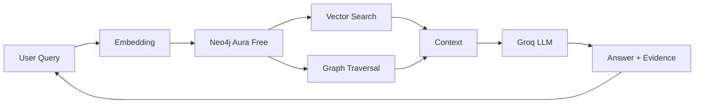

# Hybrid GraphRAG Engine (Vector + Knowledge Graph)

**Live demo:** (coming soon)

Query complex technical documents using graph traversal plus vector similarity. Demonstrates superiority over vector-only RAG on multi-hop questions.

## Architecture

## Results
(Results from evaluation will be added here with evidence links)

## Performance Comparison
| Metric | Vector-only | Hybrid (Graph+Vector) | Evidence |
|--------|-------------|----------------------|----------|
| Answer accuracy | (TBD) | (TBD) | |
| Retrieval recall | (TBD) | (TBD) | |
| Multi-hop questions | (TBD) | (TBD) | |

## Decisions (ADRs)
(Links to docs/adr/*.md will be added here)

## Security
(Link to docs/threat-model.md will be added here)

## Limitations and failure modes
- Neo4j Aura Free auto-pauses after 72 hours of inactivity
- Limited to 50K nodes / 175K relationships on free tier
- Graph quality depends on extraction accuracy
- Falls back to vector-only if graph query fails

## Operations
(Link to docs/ops.md will be added here)

## KEAL gates passed
(Link to docs/keal-gates.md will be added here)

## Run it
(Development instructions will be added as project progresses)
